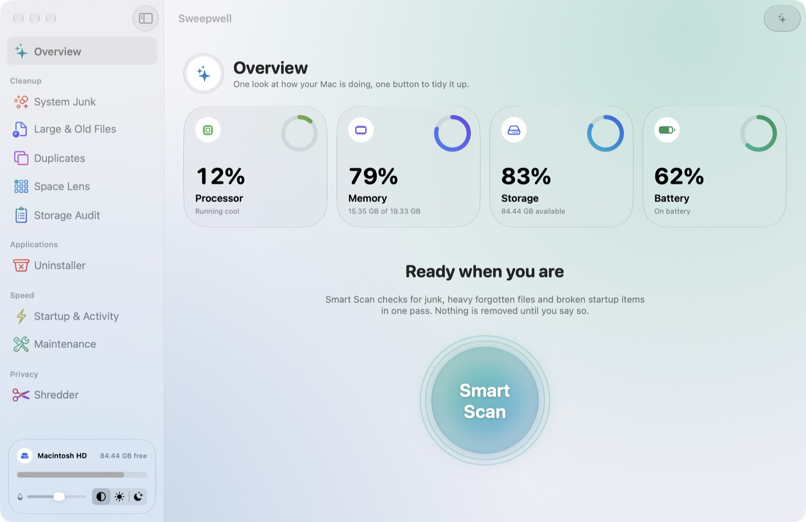

# Sweepwell

A free, open-source Mac cleaner and maintenance app for Apple silicon, built with SwiftUI.

**[Download Sweepwell](https://github.com/perseus-sepahi/sweepwell/releases/latest/download/Sweepwell.dmg)**: macOS 26 or later, Apple silicon, signed and notarized. Open the DMG, drag Sweepwell to Applications, then turn it on in System Settings ▸ Privacy & Security ▸ Full Disk Access so scans can see everything.



| Module | What it does |
| --- | --- |
| Overview | Live CPU, memory, storage and battery gauges; one-button Smart Scan |
| System Junk | App caches, logs, Xcode build data, developer tool caches, incomplete downloads, Mail downloads, Trash |
| Large & Old Files | Files over a threshold in your personal folders, filterable by size and last-opened date |
| Duplicates | Byte-for-byte identical files (size, then 64 KB hash, then full SHA-256) |
| Space Lens | Squarified treemap of any folder, with drill-down |
| Storage Audit | Read-only map of hidden caches, VMs, simulators, AI models and toolchains in groups A–F with IDs, sizes and the cost of removing each; folders go to the Trash, tool-managed items (simulator runtimes, Ollama models, Rust toolchains, Homebrew formulae…) are removed by their own tool after confirmation, and commands that could take your data with them (docker prune) are handed over to copy; accounts for space the scan cannot see. Every tool it asks gets a time limit (15 seconds; Xcode, asked alongside the folder sizing, 30); a stuck one is skipped and named in the results |
| Uninstaller | Removes an app together with its `~/Library` support files |
| Startup & Activity | Launch agents and daemons (flags broken ones), top memory consumers |
| Maintenance | Flush DNS, free inactive memory, thin snapshots, rebuild Spotlight, reset Quick Look, and more |
| Shredder | Overwrites dropped files and folders (1 random pass, or random-random-zeros) with a full flush to the drive, wipes extended attributes and the resource fork, truncates, scrambles the name, then deletes; works on open folder handles so a symlink swapped in mid-shred cannot redirect it; shows how far that goes on this Mac (FileVault, SSD/APFS, local snapshots) |

Also: a menu bar monitor, a settings window (⌘,), and day and night themes. **Auto** (the default)
follows the macOS appearance; the switch at the bottom of the sidebar forces Day or Night.

## Menu bar panel and glass

Clicking the broom in the menu bar opens a status panel:

- **A plain status line** ("All clear", "Worth a glance", "Needs a look") with the Mac model,
  uptime and how many watts the whole Mac is drawing.
- **Heads-up rows** for what actually matters: memory pressure or heavy swap, a nearly full disk (with how much of it is purgeable), overheating, broken startup items and
  battery wear. Each has one action: Quit, Details or Scan.
- **Live vitals**: processor, memory, disk, power and network, each with a graph and its top
  consumer. Clicking a row opens it in place: the facts behind the number (load averages,
  swap, purgeable space, adapter wattage, VPN state, traffic since startup, and so on) and the
  apps using it, with Quit on hover.
- **Chores**: Keep Awake for 30 minutes, 1 hour, 3 hours or until turned off (a real power
  assertion that macOS ends on time); Empty Trash, with an inline confirmation; Eject All
  mounted drives and disk images; and Smart Scan.
- **A running total** of what Sweepwell has swept.

Nothing here needs a network connection, and nothing runs in the background while the panel
and window are closed.

## Liquid Glass, Control Center style

Sweepwell uses the macOS 26 design, so it requires **macOS 26 or later**. Its look follows
Control Center: everything is a separate piece of Liquid Glass, with space around it.

- **Menu bar panel**: no container, just modules on a four-column grid. The status module
  (headline, Mac model, uptime, watts, up to three warnings), capsules for disk, memory,
  network and power with their bars and graphs, a large square for the processor (usage, top
  app, load, temperature, graph), captioned circles for chores (Keep Awake, Eject All, Empty
  Trash, Smart Scan, Settings, Quit), the Glass dial, and a capsule that opens Sweepwell and
  shows the swept total. Icons sit in white badges, and a chore turns into a white circle
  while it is on. Opening a vital, or a chore's confirmation, morphs a new module out of the
  grid. Hovering a vital shows its full one-line summary.
- **Main window**: a `NavigationSplitView` with the system's floating glass sidebar and a glass
  toolbar. Every card is its own glass module with generous corners. Buttons inside a module
  are plain capsules, so there is never glass on glass. Each section's floating bottom bar is
  glass too.
- The **Glass** slider in the sidebar, the panel and Settings sets how much tint sits inside
  the glass, from Solid to Crystal.

`scripts/ui/window.sh` and `scripts/ui/panel.sh` capture the window or the panel in a demo
home folder for design checks. They capture only Sweepwell's own windows.

## Always there

Sweepwell opens at login (on by default once it lives in an Applications folder; toggle in
Settings → Startup, or in System Settings → General → Login Items) and starts quietly in the
menu bar. Closing the window leaves the broom menu bar icon running without a Dock icon; the power
button in the menu bar panel (or ⌘Q) stops it. `Sweepwell --login-item-status` prints what macOS has on file.

## Safety model

- Removal goes to the **Trash by default** (Settings can switch to immediate deletion).
- Scanners only *offer* items. A separate `SafetyGuard` decides what may be *removed*, from the
  resolved path alone, with a narrow allow-list per purpose. Documents, Desktop, Pictures,
  Keychains, iCloud Drive, Mail and similar are refused even if a scanner bug offered them,
  and a symlinked parent folder cannot redirect a removal.
- Risky finds (iOS backups, Xcode archives, caches of running apps) are listed but never pre-ticked.
- No network access, no account, no analytics. Administrator tasks use the standard macOS
  password dialog; Sweepwell never sees the password.

## Build and install

Requires Xcode 26+ and [XcodeGen](https://github.com/yonaskolb/XcodeGen) (`brew install xcodegen`).

```bash
scripts/build-release.sh          # → dist/Sweepwell.app (arm64, ad-hoc signed)
ditto dist/Sweepwell.app /Applications/Sweepwell.app
open -a Sweepwell
```

Then grant **Full Disk Access** (System Settings → Privacy & Security) so scans can see the
Trash, Mail downloads and other apps' containers. Without it, scans are incomplete and the
first one is slow, because macOS evaluates every protected folder it refuses. An ad-hoc signed
build gets a new identity on every rebuild, so the grant has to be repeated after rebuilding.

## Trying it without touching real files

```bash
scripts/make-demo-home.sh /tmp/sweepwell-demo      # ~6 GB of fake junk, apps and duplicates
SWEEPWELL_HOME=/tmp/sweepwell-demo dist/Sweepwell.app/Contents/MacOS/Sweepwell
```

With `SWEEPWELL_HOME` set the app shows a "Demo folder" badge, only looks inside that folder,
and keeps trashed items in the folder's own `.Trash`. `SWEEPWELL_THEME=light|dark` forces a theme
for one launch without changing the saved choice.

## Licence and contact

MIT, © 2026 Perseus Sepahi. See [LICENSE](LICENSE). Sweepwell removes and overwrites the files you
select and comes with no warranty, so keep backups of anything you need. Report bugs in
[Issues](https://github.com/perseus-sepahi/sweepwell/issues).

## Layout

- `SweepwellKit/` – Swift package with all scanning and removal logic, plus tests (`swift test`).
  `SWEEPWELL_REAL_SCAN=~/Library swift test --filter RealWorldTests` compares the scanner with `du` (read-only).
- `Sweepwell/` – the SwiftUI app. `Tools/MakeAppIcon.swift` regenerates the icon.

## Not included

No malware scanner (that needs a maintained signature database to be honest), and no privileged
helper (items owned by root are handed to Finder, which asks for a password).
