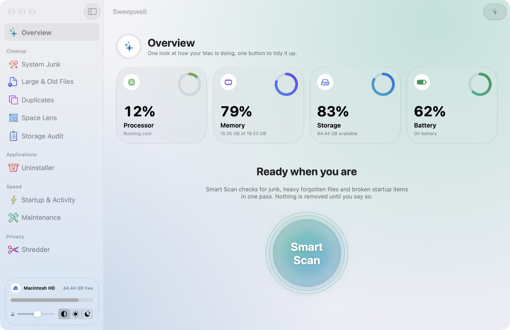

# Sweepwell

Keeps your Mac tidy: finds what is filling your disk, explains it, and removes it safely.

**[Download the latest version](https://github.com/perseus-sepahi/sweepwell-app/releases/latest/download/Sweepwell.dmg)** · [Website](https://perseus-sepahi.github.io/software/sweepwell/)

## What it does

- **System Junk and Smart Scan:** caches, logs, build leftovers and the Trash, with risky items never ticked for you.
- **Storage Audit:** hidden caches, VMs, simulators, AI models and toolchains, each with its size and what removing it costs.
- **Space Lens, Large Files and Duplicates:** see where the space went, down to byte-for-byte identical files.
- **Uninstaller:** removes an app together with the support files it scatters around.
- **Shredder:** overwrites files before deleting them, and says plainly how far that goes on an SSD.
- **Menu bar panel** in Liquid Glass: live readings, which apps use what, Keep Awake and Eject.

Nothing is removed until you pick it, and files go to the Trash by default.

## Price

The first 7 days are free with everything unlocked. After that, every scan and report, Space Lens, the menu bar panel, Keep Awake, Eject and Empty Trash stay free, and cleaning, removing, uninstalling and shredding need Sweepwell Pro: **US$1.99 once**, with no subscription and no account.

## Install

Download `Sweepwell.dmg`, open it and drag Sweepwell to Applications. It is signed and notarized by Apple. Then turn on Sweepwell in **System Settings ▸ Privacy & Security ▸ Full Disk Access** so scans can see everything.

Requires macOS 26 or later on Apple silicon.

## Privacy

No accounts, no analytics, no tracking. What Sweepwell finds stays on your Mac. See [PRIVACY.md](PRIVACY.md).

## Support

See the [support page](https://perseus-sepahi.github.io/software/sweepwell/support/), or open an [issue](https://github.com/perseus-sepahi/sweepwell-app/issues) with your macOS version and the steps that reproduce the problem.

## Source code

Sweepwell is not open source. This repository holds the releases, the issue tracker and the documentation.

## Licence

© 2026 Perseus Sepahi. See [LICENSE.md](LICENSE.md).
